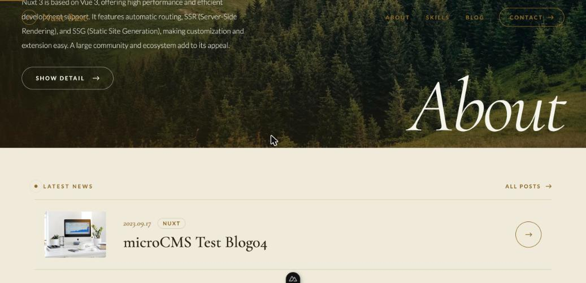
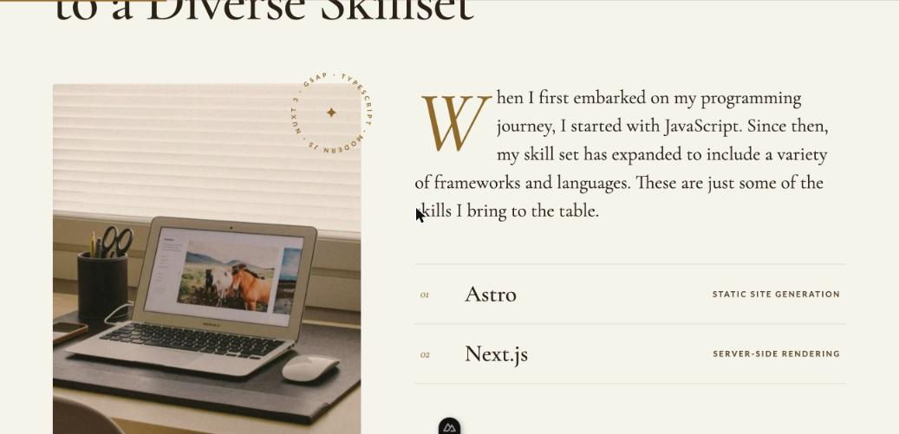
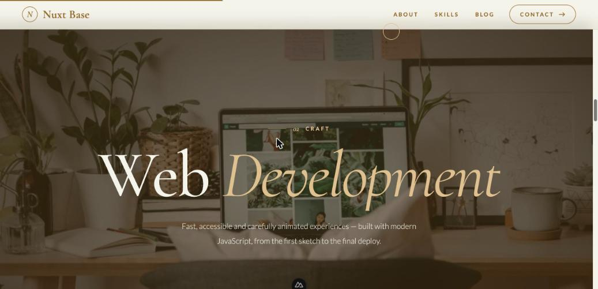

# Nuxt Base

[English](README.md) | **日本語**

Nuxt 4 / TypeScript / GSAP / microCMS で作ったポートフォリオサイトです。
ScrollTrigger によるヒーローのマスク拡大アニメーションと、ブログ(microCMS)・お問い合わせフォーム(Nodemailer + reCAPTCHA v3)を備えています。

## Screenshots

| Hero | About / Latest News |
| --- | --- |
|  |  |

| Skills | Craft |
| --- | --- |
|  |  |

## Features

- Nuxt 4 構成: `app/` ディレクトリ、`shared/` の共有型、型付き `useFetch`、クライアント専用の reCAPTCHA プラグイン、Contact / Footer の遅延ハイドレーション
- ローディングで文字の輪郭をなぞって描画 → マスクが拡大してコンテンツが現れるヒーロー(GSAP ScrollTrigger)
- Latest News / Skills / Marquee / Approach / Blog / CTA / Contact のトップページ構成
- スクロール連動のテキスト・画像リビール、カスタムカーソル、スクロール進捗バー、マグネティックボタン
- microCMS から取得するブログ一覧・記事詳細(`/api/blogs`、サーバールート経由で API キーを秘匿)
- 自前のお問い合わせフォーム(vee-validate + reCAPTCHA v3 + Nodemailer)
- `prefers-reduced-motion` 対応、レスポンシブ対応

## Tech Stack

- [Nuxt 4](https://nuxt.com/) / Vue 3 / TypeScript
- [GSAP](https://gsap.com/) + ScrollTrigger
- [microCMS](https://microcms.io/)
- Nodemailer / vee-validate / vue-recaptcha-v3
- Sass、Google Fonts(Cormorant Garamond / Lato / Nanum Myeongjo)

## Setup

```bash
npm install
cp .env.example .env   # 値を設定
npm run dev            # http://localhost:3000
```

### 環境変数

`.env.example` を参照してください(microCMS のサービスドメイン / API キー、メール送信先と SMTP、reCAPTCHA のシークレットキー)。

## Scripts

```bash
npm run dev       # 開発サーバー
npm run build     # 本番ビルド
npm run preview   # ビルドのプレビュー
npm run generate  # 静的生成
npm run typecheck # 型チェック(nuxt typecheck)
```

## Directory

```
app/
  assets/scss/   style.scss(ヒーロー・共通) / design.scss(各セクション・下層ページ)
  components/    Header / Footer / Contact / Cta
  composables/   useReveal(スクロールリビール) / usePageReveal
  pages/         index / about / skills / blog / articles/[slug] / thanks / error
  plugins/       recaptcha.client.ts
  utils/         formatDate
  error.vue      404・エラーページ
server/api/      blogs(microCMS) / contact(メール送信)
shared/types/    app と server で共有する記事の型
```

## Credits

- Skills セクションの写真: [Aleksi Tappura / Unsplash](https://unsplash.com/photos/mCg0ZgD7BgU)
