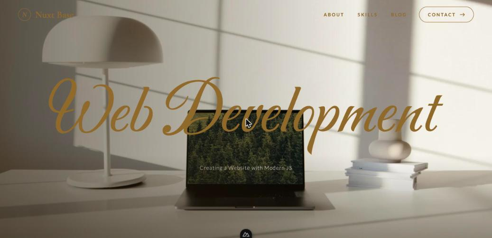
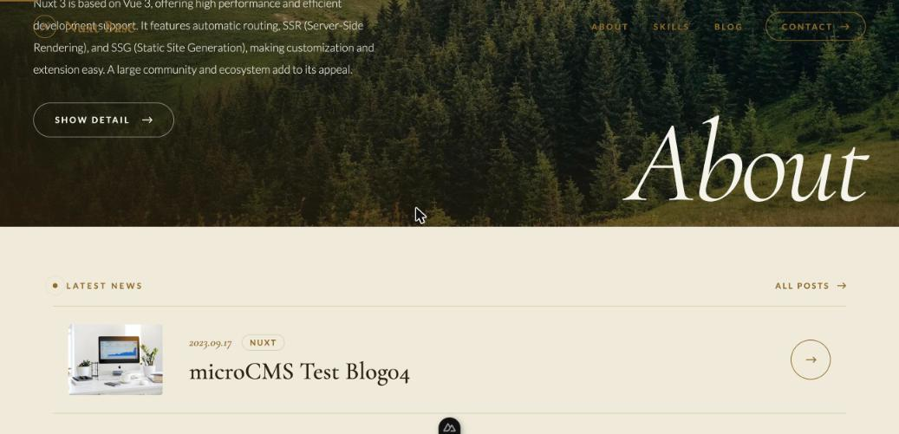
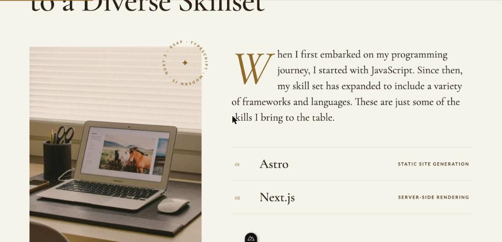
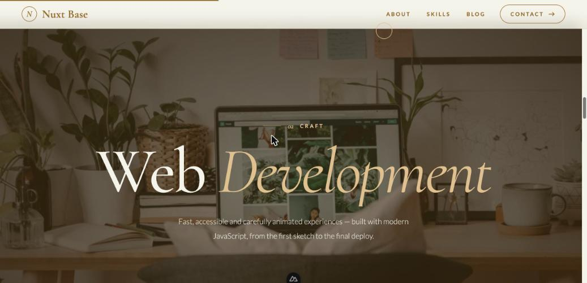

# Nuxt Base

**English** | [日本語](README.ja.md)

A portfolio site built with Nuxt 4, TypeScript, GSAP and microCMS.
It features a ScrollTrigger-driven hero with a mask-zoom reveal, a microCMS-powered blog, and a self-hosted contact form (Nodemailer + reCAPTCHA v3).

## Screenshots

| Hero | About / Latest News |
| --- | --- |
|  |  |

| Skills | Craft |
| --- | --- |
|  |  |

## Features

- Built on Nuxt 4: `app/` directory, shared types in `shared/`, typed `useFetch`, client-only reCAPTCHA plugin, lazy hydration for Contact and Footer
- Hero where the loader text is traced stroke by stroke, then a mask zooms in to reveal the content (GSAP ScrollTrigger)
- Home page sections: Latest News / Skills / Marquee / Approach / Blog / CTA / Contact
- Scroll-linked text and image reveals, custom cursor, scroll progress bar and magnetic buttons
- Blog list and article pages fed by microCMS (`/api/blogs`; the API key stays on the server)
- Self-hosted contact form (vee-validate + reCAPTCHA v3 + Nodemailer)
- Responsive layout and `prefers-reduced-motion` support

## Tech Stack

- [Nuxt 4](https://nuxt.com/) / Vue 3 / TypeScript
- [GSAP](https://gsap.com/) + ScrollTrigger
- [microCMS](https://microcms.io/)
- Nodemailer / vee-validate / vue-recaptcha-v3
- Sass, Google Fonts (Cormorant Garamond / Lato / Nanum Myeongjo)

## Setup

```bash
npm install
cp .env.example .env   # fill in the values
npm run dev            # http://localhost:3000
```

### Environment variables

See `.env.example`: microCMS service domain and API key, the contact recipient and SMTP settings, and the reCAPTCHA secret key.

## Scripts

```bash
npm run dev       # development server
npm run build     # production build
npm run preview   # preview the production build
npm run generate  # static generation
npm run typecheck # type check (vue-tsc via nuxt typecheck)
```

## Directory structure

```
app/
  assets/scss/   style.scss (hero and shared) / design.scss (sections and sub pages)
  components/    Header / Footer / Contact / Cta
  composables/   useReveal (scroll reveal) / usePageReveal
  pages/         index / about / skills / blog / articles/[slug] / thanks / error
  plugins/       recaptcha.client.ts
  utils/         formatDate
  error.vue      404 and error page
server/api/      blogs (microCMS) / contact (mail delivery)
shared/types/    Article types shared by app and server
```

## Credits

- Skills section photo: [Aleksi Tappura / Unsplash](https://unsplash.com/photos/mCg0ZgD7BgU)
